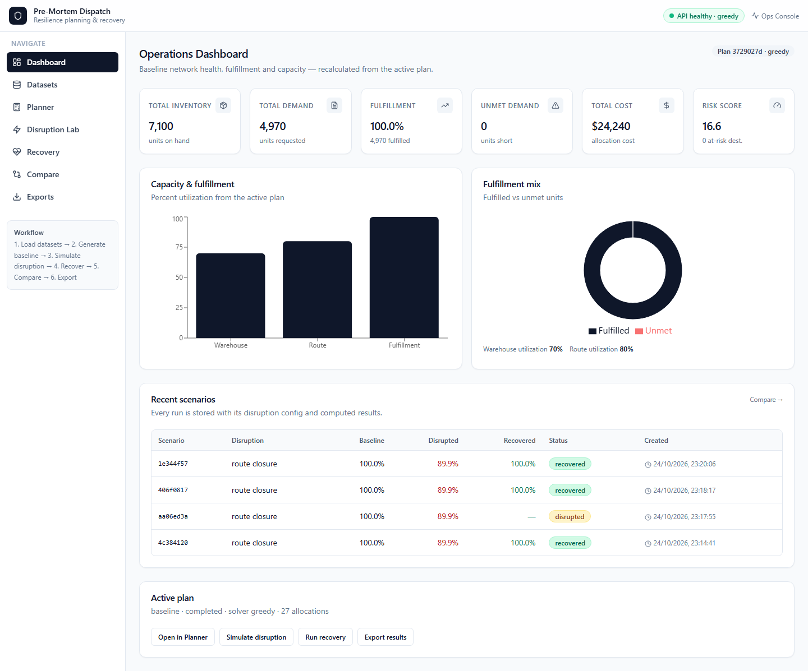
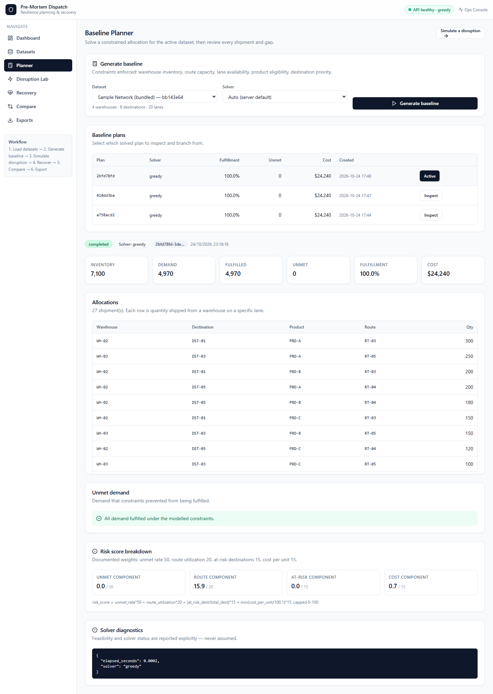
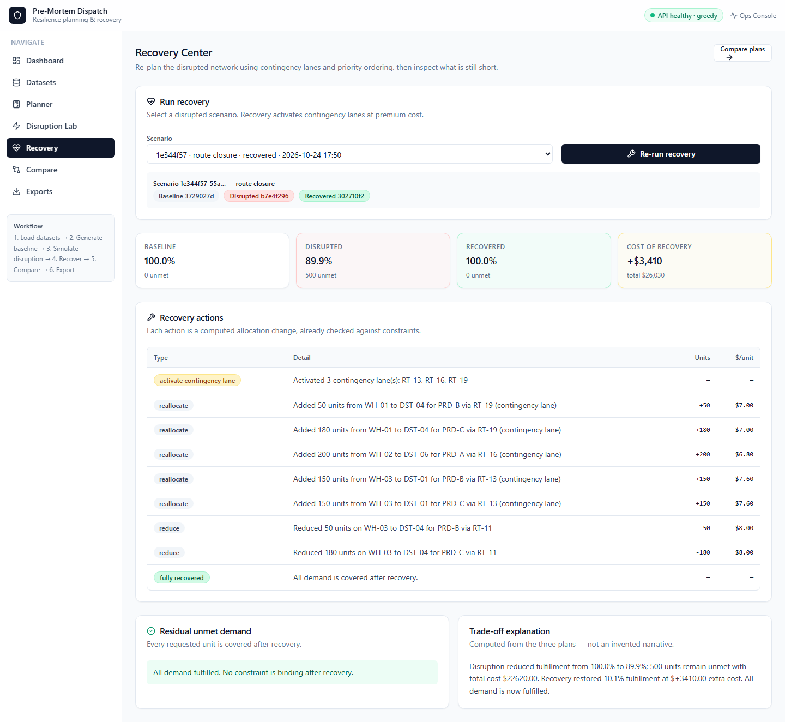
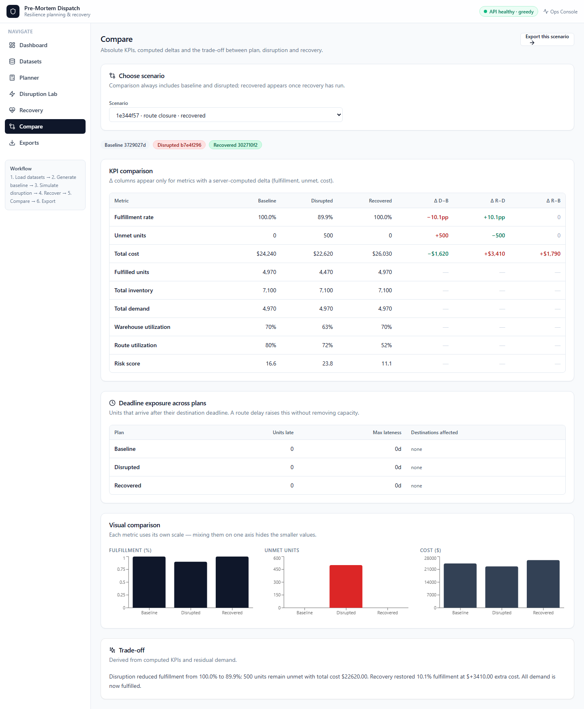

# Pre-Mortem Dispatch

**Distribution intelligence for TRIWIZATHON 2026.** Build a baseline allocation, break it with a
simulated disruption, measure the damage, and get a constraint-checked recovery plan — with every
number computed, not narrated.

> *"If this distribution plan fails under a specific disruption, what is affected, what can be
> recovered, what will it cost, and what should we do next?"*

---

## What it actually does

| Step | Screen | What happens |
|---|---|---|
| 1 | **Datasets** | Load a bundled 4-warehouse / 8-destination network, or upload six CSVs. Schema, type, duplicate and referential checks run before anything is planned. |
| 2 | **Planner** | Solves a constrained allocation: inventory, lane capacity, lane availability, product eligibility, destination priority. Shows every shipment, every gap, and the risk-score breakdown. |
| 3 | **Disruption Lab** | Mutates *real planning inputs* — reduced stock, zeroed supply, a closed lane, or added transit days — then re-solves. Impact is the difference between two computed plans. |
| 4 | **Recovery** | Re-plans using contingency lanes and priority ordering, and lists each concrete allocation change with its unit cost. |
| 5 | **Compare** | Baseline / disrupted / recovered side by side, with server-computed deltas and a written trade-off. |
| 6 | **Exports** | CSV built from the stored plan data, so it matches the screen exactly. |

### The demo story in numbers (bundled sample network)

| Plan | Fulfilment | Unmet | Cost |
|---|---|---|---|
| Baseline | **100.0%** | 0 | $24,240 |
| Close lane `RT-03` | **89.9%** | 500 | $22,620 |
| Recovery (activates `RT-13`, `RT-16`, `RT-19`) | **100.0%** | 0 | **$26,030** (+$3,410) |

That is the whole product in one line: *closing a lane costs 500 units of demand; buying it back
through contingency capacity costs $3,410.*

If recovery genuinely cannot cover demand, the app returns the residual gaps and names the
limiting destination×product rows. It never reports a success it cannot compute.

### Screens

| | |
|---|---|
|  |  |
| **Dashboard** — KPIs, capacity, recent scenario history | **Planner** — allocations, gaps, risk breakdown, solver status |
|  |  |
| **Recovery** — activated lanes, per-shipment changes, residual | **Compare** — absolute values, deltas, deadline exposure |

---

## Quick start

### Option A — two terminals (development)

```bash
# Terminal 1 — API
cd apps/api
pip install -r requirements-dev.txt
uvicorn app.main:app --reload --port 8000

# Terminal 2 — UI
cd apps/web
npm install
npm run dev            # http://localhost:5173
```

Open <http://localhost:5173>. No API key, no external service, no seed script.

### Option B — Docker Compose

```bash
docker compose up --build
# UI  http://localhost:5173
# API http://localhost:8000/docs
```

### Optional: exact solver

```bash
pip install -r apps/api/requirements-ortools.txt
SOLVER=ortools uvicorn app.main:app --port 8000
```

Without it the greedy engine runs and `diagnostics.fallback` says so — the app never pretends
OR-Tools ran.

---

## Tests

```bash
# Backend: allocation invariants + full API workflow
python -m pytest apps/api/tests -q          # 28 passed

# Frontend typecheck + production build
cd apps/web && npm run build

# Browser E2E (needs both servers running)
cd apps/web && npx playwright test          # 2 passed
```

The suite asserts invariants, not just "it returned 200":

- `Σ shipped ≤ inventory` per (warehouse, product) and `≤ capacity` per lane
- `allocated + unmet == demand` for every destination×product
- contingency lanes are **never** used by baseline/disrupted plans
- route closure removes the lane from the disrupted plan
- route delay preserves volume but raises deadline exposure (documented semantics)
- recovery restores fulfilment **and** costs more
- baseline is unchanged after a disruption is simulated against it
- identical inputs reproduce identical allocations
- exported CSV totals equal the computed plan totals

---

## Architecture

Modular monolith. `domain` → `services` → `routers`; the UI talks only HTTP.

```
apps/
  api/
    app/
      core/        config, error envelope
      domain/      schemas.py — single source of truth (Pydantic)
      routers/     health, datasets, plans, scenarios, forecast
      services/    allocation, disruption, recovery, kpi, normalize,
                   validation, reporting, ml/{interface,baseline}
      repo/        SQLite repository
    tests/
  web/
    src/           pages/, components/ui/, lib/api.ts, stores/
    e2e/           Playwright workflow spec
data/samples/      warehouses · destinations · products · routes · inventory · demand
docs/              architecture.md · api-contract.md · optimization.md
```

Full detail — data flow, invariants, objective function, risk formula — in
[`docs/architecture.md`](docs/architecture.md), [`docs/optimization.md`](docs/optimization.md) and
[`docs/api-contract.md`](docs/api-contract.md).

### Modelling decisions worth knowing

- **Objective** — minimise transport cost + a per-unit unmet penalty ($1000) weighted by
  destination priority. Fulfilling demand always beats saving freight.
- **Contingency lanes** — routes flagged `backup=true` are excluded from baseline and disrupted
  planning, and become available only during recovery at premium cost. This is what makes
  recovery a real optimisation change rather than a re-run.
- **Route delay** — raises `time_days` and therefore deadline exposure; it does **not** remove
  capacity, so fulfilment can stay at 100% while units arrive late. That is deliberate and stated
  in the UI.
- **Feasibility ≠ optimality** — the greedy engine is feasible and priority-respecting, not
  proven optimal. Every plan displays its solver and status.

---

## Data format

Six CSVs, joined by ids:

```
warehouses.csv     id,name,region,lat,lng
destinations.csv   id,name,priority,region,deadline_days          # priority 1 = most critical
products.csv       id,name,unit,weight_kg
routes.csv         id,warehouse_id,destination_id,capacity,cost_per_unit,time_days,available,product_ids,backup
inventory.csv      warehouse_id,product_id,quantity
demand.csv         destination_id,product_id,quantity
```

`product_ids` may be blank (all products allowed) or a `;`/`,` separated list.
`backup` marks contingency lanes. Templates are downloadable from the Datasets screen.

---

## Configuration

Copy `.env.example` to `.env`:

```ini
DATABASE_URL=sqlite:///./data/app.db
CORS_ORIGINS=http://localhost:5173,http://localhost:3000
SOLVER=greedy            # greedy | ortools | auto
LLM_ENABLED=false
API_PORT=8000
MAX_UPLOAD_BYTES=5242880
```

Uploads are capped per file and must be `.csv`. No secrets are required or committed.

---

## What this is not

- **Not** a claim of real-world optimality. It is a transparent model of a distribution network.
- **Not** forecasting. `GET /forecast` returns a labelled moving-average baseline (`model:
  "baseline"`, `fallback: true`). No trained model, no accuracy claim, and the allocator never
  consumes it silently.
- **Not** multi-user. No auth, no roles — those were explicitly out of scope for a single-operator
  demo, and adding them would have cost the workflow.
- **Not** LLM-dependent. An LLM may narrate computed results later; it is never the source of
  quantities, costs or feasibility.

## Roadmap without pretending

- Deadline enforcement as a hard constraint (currently a KPI)
- Trained demand forecasting once a real history exists, with backtested error
- Postgres + concurrent scenarios behind the existing repository interface
- Weight/volume constraints on lanes (product `weight_kg` is already captured)
