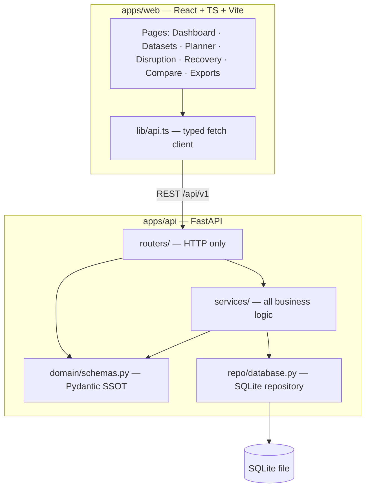
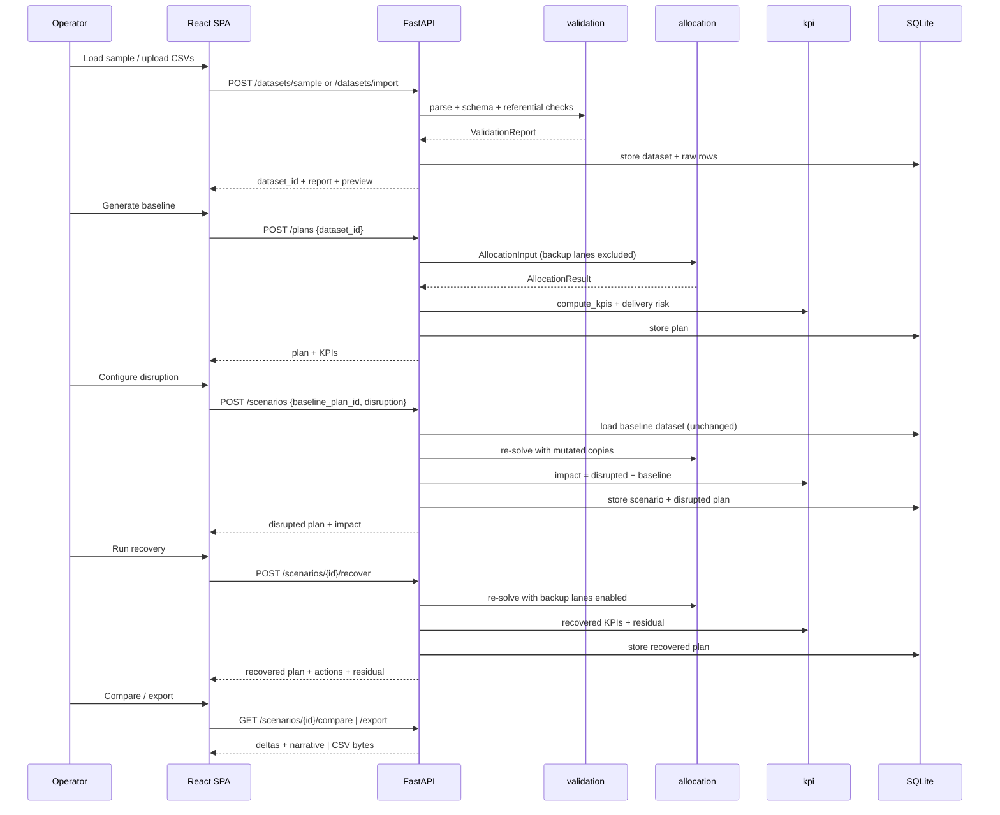

# Pre-Mortem Dispatch — Architecture

Single source of truth for boundaries, contracts and the reasoning behind them.

## 1. Shape of the system

A **modular monolith**: one FastAPI service and one React SPA, plus SQLite. No queues, no
microservices, no auth service. Every boundary below exists so that the parts can be built,
tested and replaced independently — not to distribute the deployment.

**Dependency rule.** `domain` depends on nothing. `services` depend on `domain`. `routers`
depend on `services` + `domain` and contain no allocation maths. The frontend depends only on
the HTTP surface — it never imports backend code.

## 2. Modules

| Module | Owns | Must not do |
|---|---|---|
| `routers/*` | HTTP shape, status codes, request validation | Business rules, solver logic |
| `services/allocation.py` | Greedy + optional OR-Tools allocation | Touch HTTP, format responses |
| `services/disruption.py` | Mutating planning inputs on copies | Mutate the caller's objects |
| `services/recovery.py` | Recovery re-plan and allocation diff | Claim success when infeasible |
| `services/kpi.py` | KPI + delivery-risk + risk score | Depend on persistence |
| `services/normalize.py` | CSV row → typed domain object | Silently drop rows |
| `services/validation.py` | CSV parsing + schema/referential checks | Persist anything |
| `services/reporting.py` | CSV export bytes | Recompute metrics |
| `services/ml/*` | Forecast interface + baseline fallback | Bypass feasibility |
| `repo/database.py` | Persistence | Contain business rules |
| `core/*` | Config, errors | Domain logic |

## 3. Data flow

## 4. Key invariants

1. **Baseline immutability.** A disruption never writes to the baseline plan or dataset. It
   reads the dataset, deep-copies the inventory and routes, mutates the copies, and solves.
   Verified by `test_disruption_does_not_mutate_baseline`.
2. **Conservation.** For every (destination, product): `allocated + unmet == demand`.
   Verified by `test_conservation_demand_equals_allocated_plus_unmet`.
3. **Capacity.** For every route: `Σ shipped ≤ capacity`. For every (warehouse, product):
   `Σ shipped ≤ inventory`. Verified in `test_baseline_respects_inventory_and_route_capacity`.
4. **Reproducibility.** Same dataset + same solver ⇒ identical allocations and cost.
   Verified by `test_plan_creation_is_reproducible`.
5. **Honest infeasibility.** If demand cannot be covered, residual unmet rows are returned and
   explained. No synthetic success.

## 5. Recovery model

Recovery is not "run the solver again". Two levers are genuinely applied:

1. **Contingency lanes** (`route.backup = true`) are excluded from baseline and disrupted
   planning, then made eligible during recovery at their premium `cost_per_unit`. This models a
   contracted backup carrier: dormant normally, expensive when activated.
2. **Priority ordering** — demand is served by destination priority (1 = most critical), so
   scarce capacity protects critical destinations first.

Evidence for the demo: closing `RT-03` drops fulfillment 100 % → 89.9 %; recovery re-activates
`RT-13` and restores 100 % for **+$3,410**.

If the network truly cannot cover demand, recovery returns the same residual and the comparison
narrative names the specific destination×product gaps.

## 6. Deliberate omissions

| Not built | Why |
|---|---|
| Auth / RBAC | Single-operator demo; no requirement in the workflow |
| Postgres | SQLite behind `repo/` is enough; swap is a config change |
| Microservices / queues | Adds failure modes, no benefit at this scale |
| LLM as source of truth | All figures are computed; an LLM may only narrate them |
| Trained forecasting model | No historical dataset exists — baseline MA only, clearly labelled |
